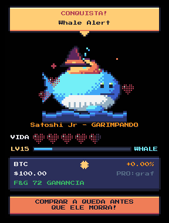
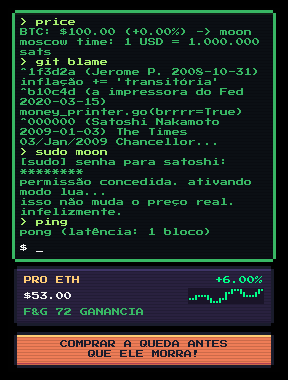

<div align="center">

# 🐣 Tamagoshi Cripto

**A pixel-art crypto pet that floats on your desktop (or lives in your terminal) and feels the market harder than you do.**

[](https://github.com/OWNER/tamagoshi-cripto/actions/workflows/ci.yml)
[](LICENSE)


[](CONTRIBUTING.md)

    

  

*eats real Bitcoin blocks · evolves into a Whale · has a hacker console*

[English](#english) · [Português](#português)

</div>

---

## English

A borderless, always-on-top, transparent desktop widget. Your pet watches the price live (CoinGecko) and changes mood:

| Mood | When | What you see |
|---|---|---|
| ⛏️ **Garimpando** (mining) | between −2% and +2% | working hard, blinking, pickaxe sparks |
| 🚀 **To the moon** | above +2% | sunglasses, rockets, gold chains |
| 💀 **REKT** | below −2% | HODL tombstone, melted hats, cardboard box, rain |

<p align="center">
   
</p>

### Meet the crew
| | Coin | Character |
|---|---|---|
|  | BTC | **Satoshinho**, dwarf miner. Rides a block-rocket on pumps, becomes a HODL tombstone on dumps |
|  | ETH | **Vitalikinho**, robot wizard with a crystal hat. Gas-fee sparks; melted hat at 999 gwei |
|  | SOL | **Solzinho**, hyperactive sun. Spins on pumps; "network down, brb" on dumps |
|  | DOGE | **Doguinho**, much wow, very moon, such loss |
|  | PEPE | **Sapo Degen**, original frog. Suit + gold chain, or living in a cardboard box |

Art: 48×48 sprites, Sweetie 16 palette, shading + ordered dithering, sel-out outlines, 4-frame idle loops, squash & stretch jumps, optional CRT scanlines, glow on neon skins. Everything is drawn **in code** (`pixel.py` + `sprites.py`). Full contact sheet: [`docs/sprites_preview.png`](docs/sprites_preview.png).

### Install

```bash
pipx install git+https://github.com/OWNER/tamagoshi-cripto     # or: pip install .
tamagoshi
```
Linux needs Tk (`sudo apt install python3-tk`). The macOS python.org installer ships with Tk; with Homebrew, run `brew install python-tk`.
Prebuilt **.app** (macOS) and **.exe** (Windows) builds are attached to each [release](https://github.com/OWNER/tamagoshi-cripto/releases).

### Terminal mode (for devs) 💻

```bash
tamagoshi --tui --coin PEPE
```


Truecolor half-block rendering (`▀`), live prices, `space` to pet, `c` to cycle coins, `q` to quit. All coins are unlocked in the terminal.

### CLI

```
tamagoshi [--tui] [--coin BTC|ETH|SOL|DOGE|PEPE] [--skin NAME|plugin:ID] [--scale 1-6]
          [--crt] [--mute] [--config PATH] [--skins-dir DIR] [--no-tray] [--no-api] [--status]
          [--list-skins] [--version]
```

### Controls
- **Drag**: hold left click · **Pet**: click the creature (jump + hearts + sound) · **Menu**: right click (or ctrl-click on Mac)
- **Keyboard** (widget focused): `h j k l` move 10 px, `H J K L` 50 px, <kbd>`</kbd> console
- Menu: coin, skin, watch-only wallet, console, show in sats, settings, price alerts, achievements, mute, CRT, start at login, hide to tray, activate Pro, quit

### What's inside
| Feature | Source (keyless) | Offline? | Tier |
|---|---|---|---|
| ⛓️ **Eats every new BTC block** (flying block, crumbs, "bloco #N comido" toast, +25 XP) | mempool.space `/v1/blocks` | waits quietly | Free |
| 🍔 **Hunger = mempool fee rate** (≤5 sat/vB fed … >60 starving + sweat drops) | mempool.space `/v1/fees/recommended` | `?` | Free |
| 😴 **Sleeps when no block for 30+ min** ("esperando bloco... zzz") | block timestamp | — | Free |
| ⛽ **ETH gas** mood (Vitalikinho) | public RPC `ethereum-rpc.publicnode.com` | `?` | Free (TUI) / Pro (window) |
| ⚡ **Hash rate** stat | mempool.space `/v1/mining/hashrate/3d` | `?` | Free |
| 🧬 **Evolution**: egg → baby → adult → **Whale** or **Diamond Hands** (3+ crashes survived), level + XP bar | local | ✅ | Free |
| 👀 **Watch-only BTC address**: reacts to incoming tx / balance changes | mempool.space `/address/<addr>` | keeps last value | Free |
| `>_` **Hacker console** (backtick) — also in `--tui` | — | ✅ | Free |
| 🕹️ **hjkl** moves the widget (HJKL = big steps) | — | ✅ | Free |
| 🇷🇺 **Moscow time / sats** toggle (`sats` or menu) | — | ✅ | Free |
| 🏆 Nerd achievements (Genesis Block, Proof of Work 100, Not Your Keys, Whale Alert, `sudo`, `rm -rf /`, Moscow Time…) | local | ✅ | Free |
| 🔌 **Local JSON API** `/status` for polybar / sketchybar / OBS | `127.0.0.1:8737` | ✅ | Free |


#### On-chain pet
Every 60 s a background thread asks mempool.space for the tip. The **first** tip seen only calibrates
(the pet doesn't binge on old blocks); after that every new height is eaten (max 6 at once after a long nap).
No network? Everything shows `?`, the pet keeps reacting to price and nothing crashes.

#### Watch-only wallet 🔒
Menu → *Carteira watch-only* (or `wallet bc1q...` in the console). Paste a **public address** (`bc1…`, `1…`, `3…`).
The pet celebrates incoming sats and cries on outgoing ones.

> **⚠️ The app NEVER asks for, stores or needs a private key, seed phrase or xprv.** It is read-only:
> only the public address is saved in your config and sent to mempool.space. If you paste anything that looks
> like a private key / WIF / xprv / 12-24 word seed, it is **refused** with a warning and never stored.
> (Privacy note: mempool.space learns which address you watch. Self-host mempool if that matters to you.)

#### Hacker console
Press <kbd>`</kbd> on the widget (or <kbd>`</kbd> / <kbd>:</kbd> in `--tui`). ↑/↓ history, `clear`, `exit`.

| command | does |
|---|---|
| `help` | list everything |
| `price` · `stats` · `neofetch` | price / XP, stage, uptime / a neofetch with the sprite |
| `feed` · `pet` | snack (no XP, nice try) / pet |
| `mempool` · `halving` · `hashrate` · `gas` · `fng` | live chain stats |
| `wallet [addr]` · `sats` | watch-only address / Moscow-time toggle |
| `skin <name>` · `coin <X>` | switch look / coin |
| `sudo moon` | you are now root. still doesn't pump. |
| `rm -rf /` | the pet panics |
| `git blame` | it was the Fed |
| `whoami` · `ls` · `cat` · `ping` | 🤫 |

#### Local API (polybar / sketchybar / OBS)
```bash
curl -s localhost:8737/status | jq .btc      # {"bloco": 921339, "fee_sat_vb": 3, "fome": "SACIADO", ...}
curl -s localhost:8737/status.txt            # 🚀 BTC $67,123.00 +2.41% LV7
tamagoshi --status                           # same JSON from the CLI
```
Bound to `127.0.0.1` only. Port via `TAMAGOSHI_API_PORT`, off with `--no-api`. Ready-made
[sketchybar plugin, polybar module and OBS overlay](examples/).

### More nerd stuff 🤓
- **Fear & Greed index** ([alternative.me](https://alternative.me/crypto/fear-and-greed-index/)) in the panel. Extreme greed slowly heals the pet; extreme fear hurts it.
- **Block height + halving countdown**: pet Satoshinho 5 times (data from [mempool.space](https://mempool.space)).
- **Lore phrases** per coin plus a degen phrasebook (`ser`, `few understand`, `probably nothing`...).
- **Konami code** (↑↑↓↓←→←→BA, with the pet focused) unlocks a secret golden skin. 🤫
- **Life meter** (pixel hearts) and **achievements**: first moon, survived 3 crashes, HODL 24h, pet lover...
- **8-bit sounds** generated at runtime (square waves → WAV). No audio files in the repo.

### Free vs Pro

| | Free | Pro |
|---|---|---|
| BTC pet, animations, reactions, hearts, achievements, sounds, lore, CRT | ✅ | ✅ |
| Community creatures (plugins) + terminal mode (all coins) | ✅ | ✅ |
| ETH, SOL, DOGE, PEPE in the desktop window | | ✅ |
| Premium skins (cyberpunk, cat, frog) | | ✅ |
| Custom thresholds and reference price, price alerts, sparkline | | ✅ |
| Start at login | | ✅ |

### Configuration
`~/.tamagoshi_cripto.json` (override with `$TAMAGOSHI_CONFIG` or `--config`):

| key | default | |
|---|---|---|
| `moeda` | `"BTC"` | current coin |
| `skin` | `"padrao"` | `padrao`, `cyberpunk`, `gato`, `sapo`, `plugin:<id>` |
| `escala` | `3` | sprite zoom (48 px × scale) |
| `crt` | `false` | scanlines |
| `mudo` | `false` | sounds off |
| `limite_alta` / `limite_queda` | `2.0` / `-2.0` | mood thresholds in % (Pro) |
| `preco_referencia` | `{}` | e.g. `{"BTC": 65000}` (Pro). Empty means the first price seen |
| `alertas` | `{}` | e.g. `{"BTC": {"acima": 70000, "abaixo": 60000}}` (Pro) |
| `menubar_mac` | `false` | experimental macOS menu bar icon |
| `unidade` | `"usd"` | `"sats"` = Moscow time |
| `carteira` | `""` | public BTC address (watch-only). Never a key |
| `api` | `true` | local HTTP API on 127.0.0.1 |
| `onchain` | `true` | block/fee/hashrate/gas polling |
| `progresso` / `evolucao` | — | life, achievements, XP (managed by the app) |

### Platform notes
| | Windows | macOS | Linux |
|---|---|---|---|
| Transparent window | color key | `systemTransparent` | semi-transparent |
| Pixel font | bundled bitmap font (no install) | same | same |
| Sound | `winsound` | `afplay` | `aplay` / `paplay` |
| Tray / menu bar | ✅ pystray | experimental (`menubar_mac`) | — |
| Start at login | `HKCU\…\Run` | LaunchAgent plist | — |

### Contribute a creature 🐣
Drop a 192×192 sprite sheet and a `skin.json` in a folder and you're done. See **[CONTRIBUTING.md](CONTRIBUTING.md)**. The example `plugin:slime` ships with the app.

### Build
```bash
./tools/build_mac.sh          # → dist/Tamagoshi Cripto.app
tools\build_windows.bat       # → dist\TamagoshiCripto.exe
```
Pushing a `v*` tag triggers `.github/workflows/release.yml`, which builds both and attaches them to a GitHub Release.

### Open-core & licensing
Code and art are **MIT**. Pro is unlocked by a license key checked against a secret that is **not** in the repo. It's injected at release time from the `TAMAGOSHI_LICENSE_SECRET` GitHub secret into a git-ignored `_segredo.py`. Dev builds use a dev secret. To switch to online validation, see the Gumroad notes in `src/tamagoshi_cripto/license.py`.
Not financial advice. The pet is emotionally unstable by design.

---

## Português

Um bichinho em pixel art que flutua na sua tela (sem bordas, sempre no topo, fundo transparente) e muda de humor com o mercado: **garimpando** (entre −2% e +2%), **TO THE MOON** (> +2%) ou **REKT** (< −2%).

**Instalar e rodar**
```bash
pipx install git+https://github.com/OWNER/tamagoshi-cripto
tamagoshi            # janela
tamagoshi --tui      # no terminal
```

**Modo nerd (v1.1):** o bicho **come cada bloco novo do Bitcoin** (mempool.space), fica com fome quando a fee da mempool sobe, **dorme** se passar 30 min sem bloco ("esperando bloco..."), mostra hash rate e gas do ETH, **evolui** (ovo → bebê → adulto → Whale ou Diamond Hands se sobreviver a 3 crashes) com nível e barra de XP, tem **console hacker** (tecla <kbd>`</kbd>: `help`, `neofetch`, `sudo moon`, `rm -rf /`, `git blame`...), teclas **hjkl** pra mover, modo **sats / Moscow time** e uma **API local** em `127.0.0.1:8737/status` pra polybar, sketchybar e OBS ([exemplos](examples/)). Tudo com APIs grátis sem chave; sem internet ele só mostra `?`.

**Carteira watch-only:** cole só o **endereço público** (bc1/1/3). O app **nunca pede chave privada, seed ou xprv**; se você colar algo assim ele recusa e não salva. É só leitura.

**Como usar:** arraste com o botão esquerdo, clique no bicho pra fazer carinho e use o botão direito (ou ctrl-clique no Mac) pro menu.

**Free:** Satoshinho (BTC), animações, carinho, vida em corações, conquistas, sons 8-bit, Fear & Greed, contagem do halving (5 carinhos no Satoshinho), código konami (skin secreta), criaturas da comunidade, modo terminal e botão de afiliado.
**Pro:** ETH, SOL, DOGE e PEPE na janela, skins premium, limites e preço de referência configuráveis, alertas de preço, mini gráfico e "abrir ao iniciar".

**Vender a versão Pro**
1. Gere um segredo forte e salve como GitHub Secret `TAMAGOSHI_LICENSE_SECRET`.
2. Gere as chaves com `TAMAGOSHI_LICENSE_SECRET=... python tools/keygen.py cliente@email.com`, ou troque pela API de licenças do Gumroad (instruções em `license.py`).
3. Crie um tag `v1.0.0`. O GitHub Actions gera o `.app` e o `.exe` e anexa no Release.
4. Venda a licença no [Gumroad](https://gumroad.com) por um pagamento único de US$ 5–10 e distribua o app grátis.
5. Troque `LINK_AFILIADO` em `src/tamagoshi_cripto/config.py`. Confira as regras do programa de afiliados da corretora e se ela opera legalmente onde você divulga.

**Criar uma criatura:** veja o [CONTRIBUTING.md](CONTRIBUTING.md) (folha PNG de 192×192 + `skin.json`).

**Mac:** a fonte pixel é um bitmap embutido (não precisa instalar nada), o fundo usa `systemTransparent`, o som sai pelo `afplay`, "abrir ao iniciar" cria um LaunchAgent e o ícone na menu bar é experimental (`"menubar_mac": true` na config). O build é feito com `./tools/build_mac.sh`. Na primeira vez que abrir o app sem assinatura: botão direito → Abrir.
