<div align="center">

# 🐣 Tamagoshi Cripto

**A pixel-art crypto pet that floats on your desktop (or lives in your terminal) and feels the market harder than you do.**

[](https://github.com/OWNER/tamagoshi-cripto/actions/workflows/ci.yml)
[](LICENSE)


[](CONTRIBUTING.md)

    

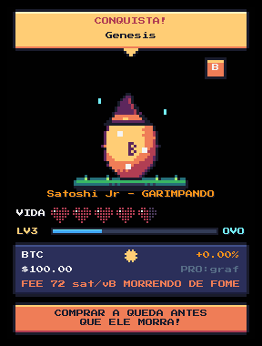  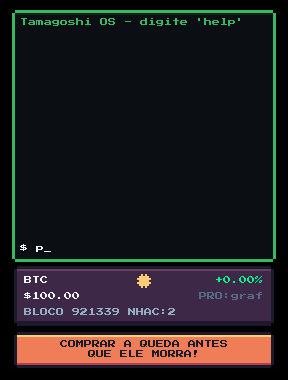

*eats real Bitcoin blocks · evolves into a Whale · has a hacker console*

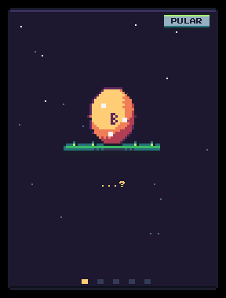 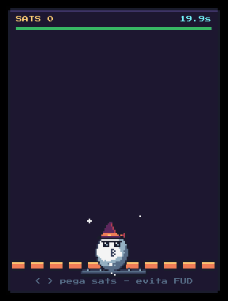 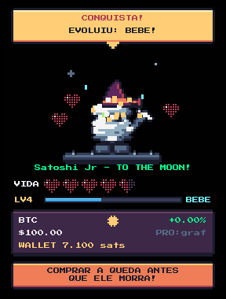

*v1.3: hatches on first run · catch-the-sats mini-game · seasonal hats, particles, chiptune*

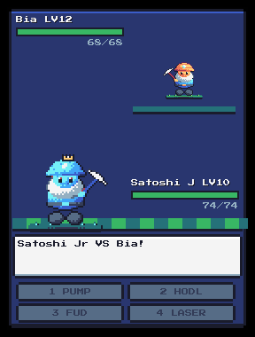 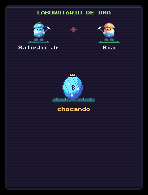 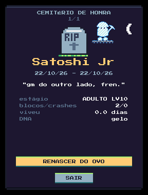 

*v1.4: turn-based battles · DNA & breeding · hardcore mode with a graveyard · GitHub profile card*

[English](#english) · [Português](#português)

</div>

---

## English

A borderless, always-on-top, transparent desktop widget. Your pet watches the price live (CoinGecko) and changes mood:

| Mood | When | What you see |
|---|---|---|
| ⛏️ **Garimpando** (mining) | between −2% and +2% | working hard, blinking, pickaxe sparks |
| 🚀 **To the moon** | above +2% | sunglasses, rockets, gold chains |
| 💀 **REKT** | below −2% | HODL tombstone, melted hats, cardboard box, rain |

<p align="center">
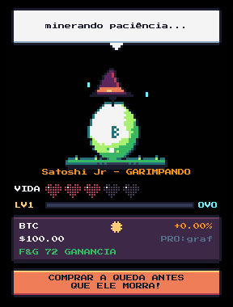  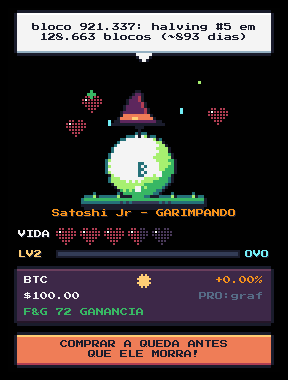 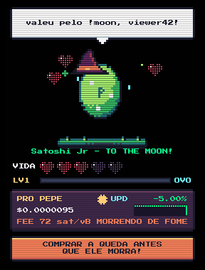
</p>

### Meet the crew
| | Coin | Character |
|---|---|---|
|  | BTC | **Satoshinho**, dwarf miner. Rides a block-rocket on pumps, becomes a HODL tombstone on dumps |
|  | ETH | **Vitalikinho**, robot wizard with a crystal hat. Gas-fee sparks; melted hat at 999 gwei |
|  | SOL | **Solzinho**, hyperactive sun. Spins on pumps; "network down, brb" on dumps |
|  | DOGE | **Doguinho**, much wow, very moon, such loss |
|  | PEPE | **Sapo Degen**, original frog. Suit + gold chain, or living in a cardboard box |

Art: 48×48 sprites, Sweetie 16 palette, shading + ordered dithering, sel-out outlines, 4-frame idle loops, squash & stretch jumps, optional CRT scanlines, glow on neon skins. Everything is drawn **in code** (`pixel.py` + `sprites.py`). Full contact sheet: [`docs/sprites_preview.png`](docs/sprites_preview.png).

### Install

```bash
pipx install git+https://github.com/OWNER/tamagoshi-cripto     # or: pip install .
tamagoshi
```
Linux needs Tk (`sudo apt install python3-tk`). The macOS python.org installer ships with Tk; with Homebrew, run `brew install python-tk`.
Prebuilt **.app** (macOS) and **.exe** (Windows) builds are attached to each [release](https://github.com/OWNER/tamagoshi-cripto/releases).

### Terminal mode (for devs) 💻

```bash
tamagoshi --tui --coin PEPE
```
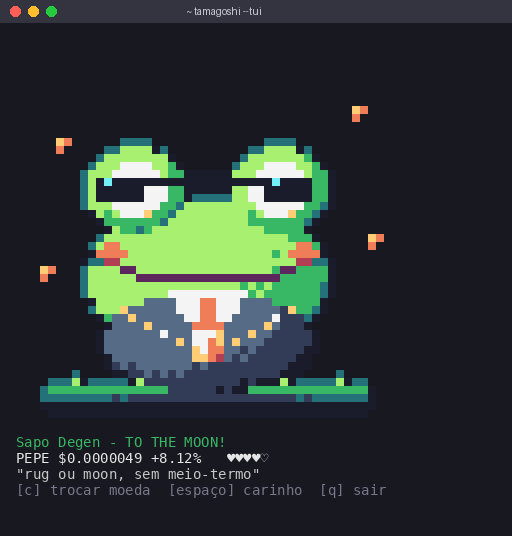

Truecolor half-block rendering (`▀`), live prices, `space` to pet, `c` to cycle coins, `q` to quit. All coins are unlocked in the terminal.

### CLI

```
tamagoshi [--tui] [--coin BTC|ETH|SOL|DOGE|PEPE] [--skin NAME|plugin:ID] [--scale 1-6]
          [--crt] [--mute] [--config PATH] [--skins-dir DIR] [--no-tray] [--no-api] [--status]
          [--list-skins] [--version]
```

### Controls
- **Drag**: hold left click · **Pet**: click the creature (jump + hearts + sound) · **Menu**: right click (or ctrl-click on Mac)
- **Keyboard** (widget focused): `h j k l` move 10 px, `H J K L` 50 px, <kbd>`</kbd> console
- Menu: coin, skin, watch-only wallet, console, show in sats, settings, price alerts, achievements, mute, CRT, start at login, hide to tray, activate Pro, quit

### New in v1.5 ✨ (quality release)
One tabbed **Settings** screen (press `S`) instead of a pile of dialogs, **keyboard navigation everywhere** (TAB/ENTER/arrows/ESC),
**pt-BR / English** UI with auto-detect, unique final forms (**Ultrasound Archangel** ETH, **Supernova** SOL,
**Astronaut Doge**, **Frog King** PEPE), stage art for shop packs, AI key in the **OS keychain**, a hardened local API
(no open CORS, host check, token for write routes) and a [PRIVACY.md](PRIVACY.md). See [CHANGELOG.md](CHANGELOG.md).

### New in v1.4 🧬⚔️

**Engagement**
| | |
|---|---|
| 💀 **Hardcore mode** (opt-in, off) | life at zero for 30 min **and** no cuddle/game for 4 h → the pet dies, becomes a ghost, and its gravestone (epitaph, dates, level, blocks, crashes, DNA) goes to the **Cemitério de Honra**. *Renascer do ovo* restarts with new DNA. Menu → Genética e batalhas, or `hardcore on`, `rip` |
| 🧬 **Genetics** | every pet has genes: palette (7), eyes (4), accessory (6), pattern (4) → rarity *comum/raro/épico/lendário*. `petcode` copies a `TAMA1-…` code (checksummed text, **no NFT, no blockchain**); `breed <n|code>` mixes two adults (yours, from the stable, or a friend's code) into an egg with ~8 % mutation; `stable`, `adopt <n>` |
| ⚔️ **Battles** | turn-based: PUMP / HODL / FUD / special (LASER EYES with laser eyes, else TO THE MOON). Stats from level, stage, DNA and the coin's **24 h change**. vs AI (`battle`) or a friend's code (`battle TAMA1-…`), keys 1-4 or click, animated hits + result screen, +40 XP per win |

**Crypto**
| | |
|---|---|
| 📈 **Paper trading** | `$10.000` of **DINHEIRO FICTÍCIO** at live prices: menu → Mercado → Corretora de mentirinha, or `paper buy BTC 100`, `paper sell BTC all`, `paper hist`, `paper reset`. 0.1 % fake fee, PnL, history. The pet cheers at +5 % and cries at −5 %. The banner always says it's fake money |
| 👀 **ETH & SOL watch-only** | `wallet eth 0x…`, `wallet sol …` (or menu). Keyless public RPCs (publicnode, Solana mainnet). Refuses 64-hex private keys, base58 secret keys, `keypair.json` arrays and seed phrases — same rules as BTC |
| 🐋 **Whale alerts** | large BTC txs in the mempool (mempool.space, default ≥ 50 BTC): the pet panics, shakes, toast is clickable (opens the tx). Max 1 scare per 5 min. Toggle in menu → Mercado |
| 📰 **News** | CoinDesk + Cointelegraph RSS (keyless) every 30 min; sometimes a headline shows in the speech bubble — **click to open**. `news` in the console |

**Dev**
| | |
|---|---|
| 🪪 **GitHub profile card** | animated SVG (4 embedded frames + CSS, no JS) → [docs/PROFILE_CARD.md](docs/PROFILE_CARD.md). `export` (public fields only), `card`, `tools/profile_card.py`, `GET /card.svg`, and a copy-paste Action `.github/workflows/profile-card.yml` |
| 🧩 **VS Code extension** | `vscode/`: status bar pet + price, webview with the animated sprite. Reads the local API or CoinGecko. `npx @vscode/vsce package` → `.vsix` (not published) |
| 🤖 **`ask <question>`** | BYO OpenAI-compatible URL/key (`ai set <url> [key] [model]`, works with Ollama/LM Studio on localhost), **off by default** → funny canned answers. Sends only the question + mood/price/level; the key is masked on screen |

**Money**
| | |
|---|---|
| 🛍️ **Skin shop** | menu → Loja de skins: seasonal packs (Noites de Bruxa, Natal — included in Pro), artist collabs (Neon Nights, 70/30 revenue share, unlocked by `SKIN-…` codes from `keygen.py --pack`), brand packs. `shop`, `redeem <code>` |
| 📺 **Streamer overlay** | OBS browser source `http://127.0.0.1:8737/stream` + optional **anonymous** Twitch chat read (`!pet !moon !rekt !price !dna`) → [docs/STREAMER_OVERLAY.md](docs/STREAMER_OVERLAY.md) |
| 🏷️ **Brand skins** | sponsored pack format with mandatory **PATROCINADO** disclosure, authorization and dates; rules + pricing in [docs/BRAND_SKINS.md](docs/BRAND_SKINS.md) |

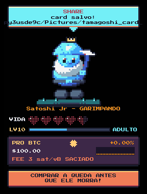 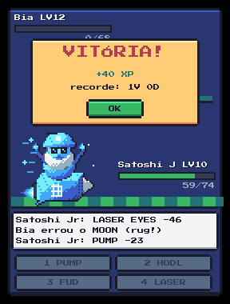 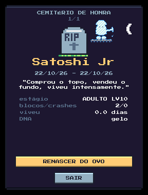 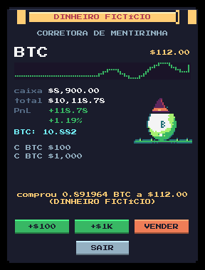 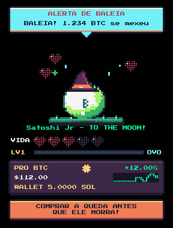 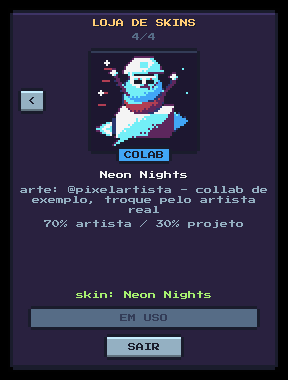
 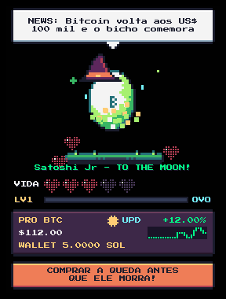 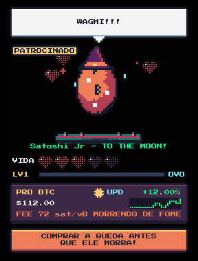

### New in v1.3 ✨
| | |
|---|---|
| 🥚 **Onboarding** | first run: the egg wobbles, cracks and hatches → pick a coin → name your pet (shown in the UI and on the share card) → quick tips → opt-ins (sound, leaderboard). `PULAR`/Esc skips; menu → Ajuda → *Rever introdução* replays it. `--skip-intro` for scripts |
| 🎮 **Mini-game "Pega os Sats"** | `P` (or console `play`, or menu): 20 s, ← → / h l / mouse to catch falling sats, dodge red FUD. 3 XP per sat (max 90). The pet gets bored after ~3 h without playing and asks for it |
| 🎵 **Chiptune v2** | 2 pulse channels + noise, envelopes and arpeggios, a jingle per event (block, moon, rekt, evolve, achievement, hatch, game). Optional background loop, **off by default** |
| 💥 **Juice** | screen shake + particles on moon/crash, day/night panel palette by local time, **seasonal hats** (halloween in October, Santa hat in December) |
| 🔑 **Licensing providers** | `hmac` (offline), **Gumroad**, **Lemon Squeezy**, **Hotmart** (via webhook key server in `server/licencas.py`). 24 h cache + **14-day offline grace**. Clear pt-BR errors |
| 🔔 **Update check** | asks GitHub Releases for the latest tag and shows a clickable "NOVA VERSÃO!" toast. **Never downloads or installs anything** |
| 🧯 **Crash log** | `~/.tamagoshi_cripto/crash.log`; menu → Ajuda → *Enviar relatório* opens a **prefilled GitHub issue** in your browser (home path stripped). You review and submit |
| ♿ **Accessibility** | 6 sizes (menu → Aparência), high-contrast mode, every effect can be turned off |
| ⚙️ **Settings migration** | configs from v1.0–v1.2 are upgraded automatically (`versao_config`) — your pet keeps its XP |
| 🪶 **Light** | ~**1.1 % of one CPU core idle** (measured, see below) |

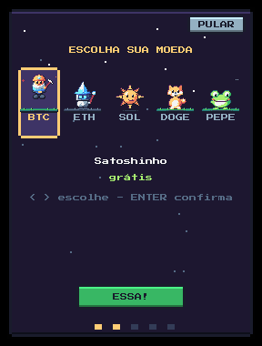 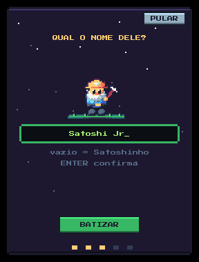 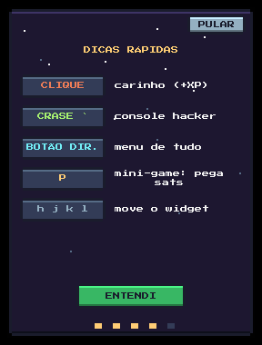 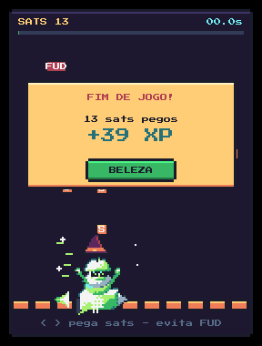 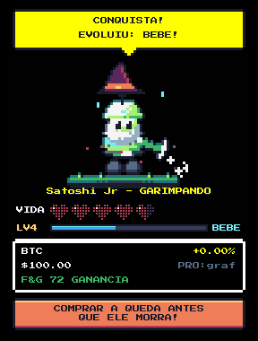 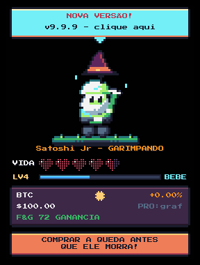

**Performance:** `xvfb-run -a python tools/medir_cpu.py 60` measures the idle widget (onboarding done, network threads on):
**1.12 %** of one core on Linux/Xvfb in v1.5 (0.45 s CPU in 40 s; v1.4: 1.25 %). The 50 ms loop only runs while the mini-game is open.

### What's inside
| Feature | Source (keyless) | Offline? | Tier |
|---|---|---|---|
| ⛓️ **Eats every new BTC block** (flying block, crumbs, "bloco #N comido" toast, +25 XP) | mempool.space `/v1/blocks` | waits quietly | Free |
| 🍔 **Hunger = mempool fee rate** (≤5 sat/vB fed … >60 starving + sweat drops) | mempool.space `/v1/fees/recommended` | `?` | Free |
| 😴 **Sleeps when no block for 30+ min** ("esperando bloco... zzz") | block timestamp | — | Free |
| ⛽ **ETH gas** mood (Vitalikinho) | public RPC `ethereum-rpc.publicnode.com` | `?` | Free (TUI) / Pro (window) |
| ⚡ **Hash rate** stat | mempool.space `/v1/mining/hashrate/3d` | `?` | Free |
| 🧬 **Evolution**: egg → baby → adult → **Whale** or **Diamond Hands** (3+ crashes survived), level + XP bar | local | ✅ | Free |
| 👀 **Watch-only BTC address**: reacts to incoming tx / balance changes | mempool.space `/address/<addr>` | keeps last value | Free |
| `>_` **Hacker console** (backtick) — also in `--tui` | — | ✅ | Free |
| 🕹️ **hjkl** moves the widget (HJKL = big steps) | — | ✅ | Free |
| 🇷🇺 **Moscow time / sats** toggle (`sats` or menu) | — | ✅ | Free |
| 🏆 Nerd achievements (Genesis Block, Proof of Work 100, Not Your Keys, Whale Alert, `sudo`, `rm -rf /`, Moscow Time…) | local | ✅ | Free |
| 🔌 **Local JSON API** `/status` for polybar / sketchybar / OBS | `127.0.0.1:8737` | ✅ | Free |
| 🖼️ **Share card** 1200×675 pixel-art PNG + prefilled X post (`share`) | local | ✅ | Free |
| 🏆 **Leaderboard** (opt-in, anonymous nickname) `rank on <nick>` | your own `server/` | "offline" message | Free |

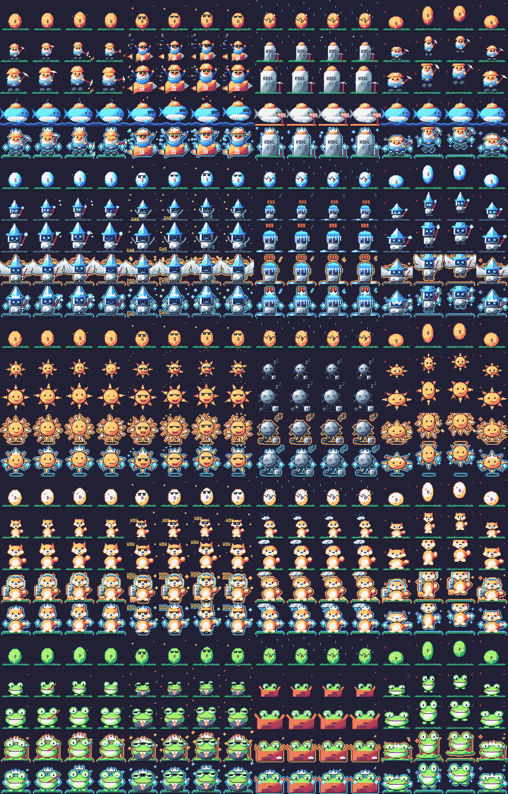

#### On-chain pet
Every 60 s a background thread asks mempool.space for the tip. The **first** tip seen only calibrates
(the pet doesn't binge on old blocks); after that every new height is eaten (max 6 at once after a long nap).
No network? Everything shows `?`, the pet keeps reacting to price and nothing crashes.

#### Watch-only wallet 🔒
Menu → *Carteira watch-only* (or `wallet bc1q...` in the console). Paste a **public address** (`bc1…`, `1…`, `3…`).
The pet celebrates incoming sats and cries on outgoing ones.

> **⚠️ The app NEVER asks for, stores or needs a private key, seed phrase or xprv.** It is read-only:
> only the public address is saved in your config and sent to mempool.space. If you paste anything that looks
> like a private key / WIF / xprv / 12-24 word seed, it is **refused** with a warning and never stored.
> (Privacy note: mempool.space learns which address you watch. Self-host mempool if that matters to you.)

#### Hacker console
Press <kbd>`</kbd> on the widget (or <kbd>`</kbd> / <kbd>:</kbd> in `--tui`). ↑/↓ history, `clear`, `exit`.

| command | does |
|---|---|
| `help` | list everything |
| `price` · `stats` · `neofetch` | price / XP, stage, uptime / a neofetch with the sprite |
| `feed` · `pet` | snack (no XP, nice try) / pet |
| `mempool` · `halving` · `hashrate` · `gas` · `fng` | live chain stats |
| `wallet [addr]` · `sats` | watch-only address / Moscow-time toggle |
| `skin <name>` · `coin <X>` | switch look / coin |
| `sudo moon` | you are now root. still doesn't pump. |
| `rm -rf /` | the pet panics |
| `git blame` | it was the Fed |
| `whoami` · `ls` · `cat` · `ping` | 🤫 |

#### Local API (polybar / sketchybar / OBS)
```bash
curl -s localhost:8737/status | jq .btc      # {"bloco": 921339, "fee_sat_vb": 3, "fome": "SACIADO", ...}
curl -s localhost:8737/status.txt            # 🚀 BTC $67,123.00 +2.41% LV7
tamagoshi --status                           # same JSON from the CLI
```
Bound to `127.0.0.1` only. Port via `TAMAGOSHI_API_PORT`, off with `--no-api`. Ready-made
[sketchybar plugin, polybar module and OBS overlay](examples/).

#### Share card
Console `share` (or menu → *Compartilhar card (X)*) renders a 1200×675 pixel-art card with the pet, stage,
level/XP, price, mood and latest achievements, saves it to `~/Pictures` (or `~`), and opens an
**X intent URL** with the text prefilled. **Nothing is posted automatically.** Attach the PNG and post it yourself.
The card never includes your watch-only address.

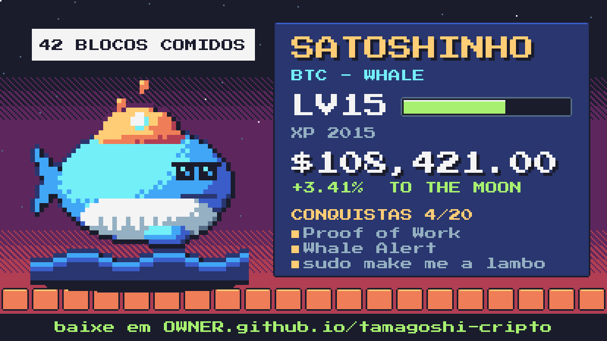

#### Leaderboard (opt-in, off by default)
`rank on <nickname>` in the console (or menu → *Ranking (opt-in)…*) turns it on. The app then sends **only**
a random device id (uuid4), the nickname, XP, level, stage, blocks eaten, achievement count and coin, every ~10 min.
No wallet, e-mail, price or IP is stored. `rank` shows the top 10, `rank off` stops sending.
The server is a ~200-line stdlib app in [`server/`](server/) (SQLite, rate limit, Dockerfile). See its README.

### Landing page
[`site/`](site/) is a static page (GitHub Pages-ready) with a live in-browser demo of the pet (CoinGecko +
mempool.space), Free vs Pro table, downloads, a Gumroad button, FAQ, EN/PT toggle and OG/Twitter cards.
Edit `site/config.js` (repo, downloads, Gumroad, ranking URL). Preview: `cd site && python -m http.server 8765`.

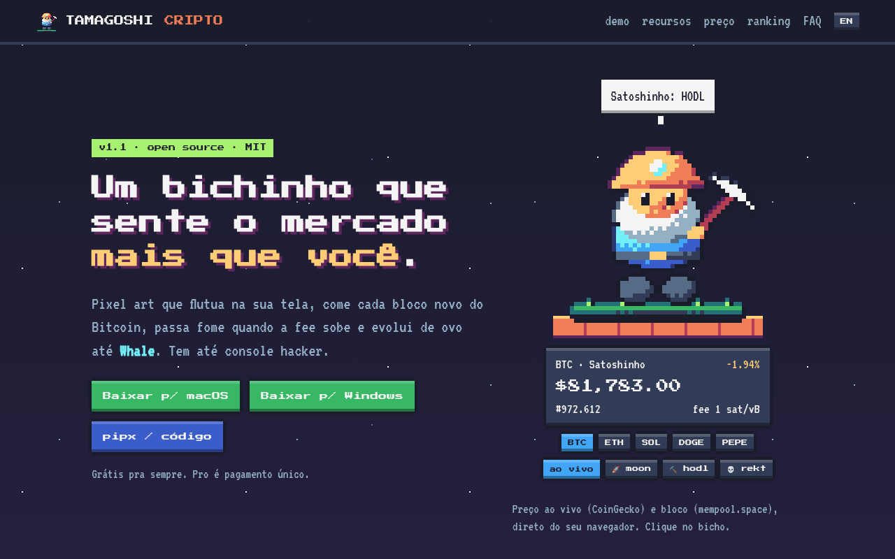 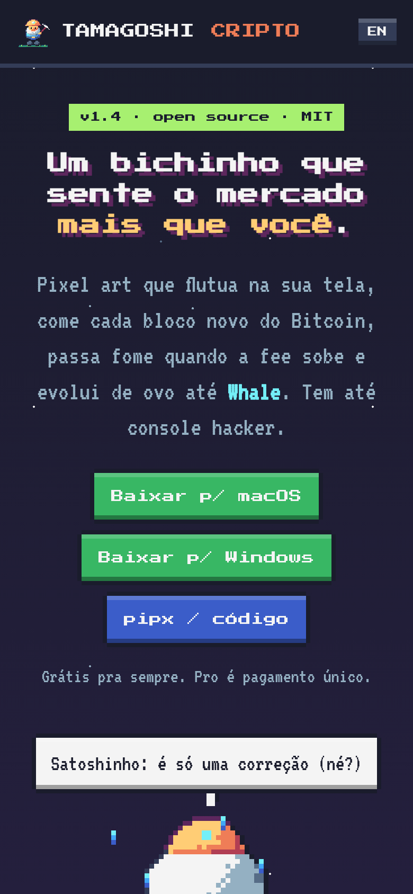

### Skin contest 🏆
Open an issue with the **Concurso de skins** template and send a PR. Validate locally with
`python tools/validate_skin.py <folder> --preview previews/`. CI checks the same rules and uploads a preview. See [CONTRIBUTING](CONTRIBUTING.md#concurso-de-skins--skin-contest).

### More nerd stuff 🤓
- **Fear & Greed index** ([alternative.me](https://alternative.me/crypto/fear-and-greed-index/)) in the panel. Extreme greed slowly heals the pet; extreme fear hurts it.
- **Block height + halving countdown**: pet Satoshinho 5 times (data from [mempool.space](https://mempool.space)).
- **Lore phrases** per coin plus a degen phrasebook (`ser`, `few understand`, `probably nothing`...).
- **Konami code** (↑↑↓↓←→←→BA, with the pet focused) unlocks a secret golden skin. 🤫
- **Life meter** (pixel hearts) and **achievements**: first moon, survived 3 crashes, HODL 24h, pet lover...
- **8-bit sounds** generated at runtime (square waves → WAV). No audio files in the repo.

### Free vs Pro

| | Free | Pro |
|---|---|---|
| BTC pet, animations, reactions, hearts, achievements, sounds, lore, CRT | ✅ | ✅ |
| Community creatures (plugins) + terminal mode (all coins) | ✅ | ✅ |
| ETH, SOL, DOGE, PEPE in the desktop window | | ✅ |
| Premium skins (cyberpunk, cat, frog) | | ✅ |
| Custom thresholds and reference price, price alerts, sparkline | | ✅ |
| Start at login | | ✅ |

### Configuration
`~/.tamagoshi_cripto.json` (override with `$TAMAGOSHI_CONFIG` or `--config`):

| key | default | |
|---|---|---|
| `moeda` | `"BTC"` | current coin |
| `skin` | `"padrao"` | `padrao`, `cyberpunk`, `gato`, `sapo`, `plugin:<id>` |
| `escala` | `3` | sprite zoom (48 px × scale) |
| `crt` | `false` | scanlines |
| `mudo` | `false` | sounds off |
| `limite_alta` / `limite_queda` | `2.0` / `-2.0` | mood thresholds in % (Pro) |
| `preco_referencia` | `{}` | e.g. `{"BTC": 65000}` (Pro). Empty means the first price seen |
| `alertas` | `{}` | e.g. `{"BTC": {"acima": 70000, "abaixo": 60000}}` (Pro) |
| `menubar_mac` | `false` | experimental macOS menu bar icon |
| `unidade` | `"usd"` | `"sats"` = Moscow time |
| `carteira` | `""` | public BTC address (watch-only). Never a key |
| `api` | `true` | local HTTP API on 127.0.0.1 |
| `onchain` | `true` | block/fee/hashrate/gas polling |
| `ranking` / `ranking_url` / `nick` | `false` / `""` / `""` | opt-in leaderboard |
| `site` | `https://OWNER.github.io/tamagoshi-cripto` | link printed on the share card |
| `nome_pet` | `""` | pet nickname (onboarding). Empty = coin default |
| `licenca_provedor` | `"hmac"` | `hmac` · `gumroad` · `lemonsqueezy` · `servidor` (Hotmart) |
| `licenca_produto` / `licenca_url` | `""` | product id (Gumroad/Lemon) / key server URL (Hotmart) |
| `musica` / `volume` | `false` / `0.35` | background chiptune loop / volume |
| `dia_noite` / `chapeus` / `juice` / `alto_contraste` | `true` / `true` / `true` / `false` | visuals & accessibility |
| `checar_updates` | `true` | ask GitHub for a newer release (notice only) |
| `progresso` / `evolucao` | — | life, achievements, XP (managed by the app) |

### Platform notes
| | Windows | macOS | Linux |
|---|---|---|---|
| Transparent window | color key | `systemTransparent` | semi-transparent |
| Pixel font | bundled bitmap font (no install) | same | same |
| Sound | `winsound` | `afplay` | `aplay` / `paplay` |
| Tray / menu bar | ✅ pystray | experimental (`menubar_mac`) | — |
| Start at login | `HKCU\…\Run` | LaunchAgent plist | — |

### Contribute a creature 🐣
Drop a 192×192 sprite sheet and a `skin.json` in a folder and you're done. See **[CONTRIBUTING.md](CONTRIBUTING.md)**. The example `plugin:slime` ships with the app.

### Build
```bash
./tools/build_mac.sh          # → dist/Tamagoshi Cripto.app
tools\build_windows.bat       # → dist\TamagoshiCripto.exe
```
Pushing a `v*` tag triggers `.github/workflows/release.yml`, which builds both and attaches them to a GitHub Release.

### Open-core & licensing
Code and art are **MIT**. Pro is unlocked by a license key checked against a secret that is **not** in the repo. It's injected at release time from the `TAMAGOSHI_LICENSE_SECRET` GitHub secret into a git-ignored `_segredo.py`. Dev builds use a dev secret. To switch to online validation, see the Gumroad notes in `src/tamagoshi_cripto/license.py`.
Not financial advice. The pet is emotionally unstable by design.

---

## Português

Um bichinho em pixel art que flutua na sua tela (sem bordas, sempre no topo, fundo transparente) e muda de humor com o mercado: **garimpando** (entre −2% e +2%), **TO THE MOON** (> +2%) ou **REKT** (< −2%).

**Instalar e rodar**
```bash
pipx install git+https://github.com/OWNER/tamagoshi-cripto
tamagoshi            # janela
tamagoshi --tui      # no terminal
```

**Modo nerd (v1.1):** o bicho **come cada bloco novo do Bitcoin** (mempool.space), fica com fome quando a fee da mempool sobe, **dorme** se passar 30 min sem bloco ("esperando bloco..."), mostra hash rate e gas do ETH, **evolui** (ovo → bebê → adulto → Whale ou Diamond Hands se sobreviver a 3 crashes) com nível e barra de XP, tem **console hacker** (tecla <kbd>`</kbd>: `help`, `neofetch`, `sudo moon`, `rm -rf /`, `git blame`...), teclas **hjkl** pra mover, modo **sats / Moscow time** e uma **API local** em `127.0.0.1:8737/status` pra polybar, sketchybar e OBS ([exemplos](examples/)). Tudo com APIs grátis sem chave; sem internet ele só mostra `?`.

**Novidades v1.2:** `share` gera um card 1200×675 em pixel art e abre o X com o texto pronto (quem posta é você). `rank on <apelido>` liga o ranking (opcional, desligado por padrão; envia só apelido + stats do bicho). Site de vendas em `site/` e concurso de skins (template de issue + `tools/validate_skin.py` + Action).

**Carteira watch-only:** cole só o **endereço público** (bc1/1/3). O app **nunca pede chave privada, seed ou xprv**; se você colar algo assim ele recusa e não salva. É só leitura.

**Como usar:** arraste com o botão esquerdo, clique no bicho pra fazer carinho e use o botão direito (ou ctrl-clique no Mac) pro menu.

**Free:** Satoshinho (BTC), animações, carinho, vida em corações, conquistas, sons 8-bit, Fear & Greed, contagem do halving (5 carinhos no Satoshinho), código konami (skin secreta), criaturas da comunidade, modo terminal e botão de afiliado.
**Pro:** ETH, SOL, DOGE e PEPE na janela, skins premium, limites e preço de referência configuráveis, alertas de preço, mini gráfico e "abrir ao iniciar".

**Novidades v1.5 (qualidade):** tela única de **Ajustes** com abas (tecla `S`), **teclado em tudo**, interface **pt-BR/EN** com auto-detecção, formas finais únicas pra ETH/SOL/DOGE/PEPE, estágios nos pacotes da loja, chave da IA no **chaveiro do sistema**, API local blindada e [PRIVACY.md](PRIVACY.md). Detalhes no [CHANGELOG.md](CHANGELOG.md).

**Novidades v1.4:** **modo hardcore** opcional (o bicho pode morrer de abandono, vira fantasma e vai pro **Cemitério de Honra** com epitáfio; renasce do ovo), **DNA** (paleta, olhos, acessório, padrão, raridade) com **cruzamento** via código de pet `TAMA1-...` (texto, sem NFT/blockchain), **batalhas por turnos** (vs IA ou código de amigo; força vem do nível, DNA e da variação 24h), **paper trading** com DINHEIRO FICTÍCIO, carteiras **ETH/SOL watch-only** (mesma recusa de chave/seed), **alerta de baleia** (mempool.space), **manchetes RSS** clicáveis no balão, **card de perfil do GitHub** em SVG animado, **extensão do VS Code** (`vscode/`), `ask` com IA **BYO** (desligada: responde piada), **loja de skins** (sazonais, collab com artista via código, pacotes de marca sempre com selo **PATROCINADO**) e **overlay de streamer** pro OBS com chat da Twitch anônimo. Tudo sem chave de API.

**Novidades v1.3:** ovo chocando na primeira vez (escolhe moeda, dá nome, dicas, opt-ins — dá pra pular), mini-game **Pega os Sats** (tecla P), trilha chiptune nova (música de fundo opcional, desligada), tremidinha e partículas no moon/crash, paleta dia/noite, **chapéu de halloween** (outubro) e de Natal, alto contraste e 6 tamanhos, aviso de versão nova (nunca instala sozinho), log de crash com "enviar relatório" (só abre uma issue preenchida), licença via Gumroad, Lemon Squeezy, Hotmart ou offline, com 14 dias de graça sem internet. Uso de CPU parado: ~1%.

**Testar no Mac:** [docs/TESTE_MAC.md](docs/TESTE_MAC.md).

**Pra colocar no ar:** veja o [docs/GO_LIVE.md](docs/GO_LIVE.md).

**Vender a versão Pro**
1. Gere um segredo forte e salve como GitHub Secret `TAMAGOSHI_LICENSE_SECRET`.
2. Gere as chaves com `TAMAGOSHI_LICENSE_SECRET=... python tools/keygen.py cliente@email.com`, ou troque pela API de licenças do Gumroad (instruções em `license.py`).
3. Crie um tag `v1.0.0`. O GitHub Actions gera o `.app` e o `.exe` e anexa no Release.
4. Venda a licença no [Gumroad](https://gumroad.com) por um pagamento único de US$ 5–10 e distribua o app grátis.
5. Troque `LINK_AFILIADO` em `src/tamagoshi_cripto/config.py`. Confira as regras do programa de afiliados da corretora e se ela opera legalmente onde você divulga.

**Criar uma criatura:** veja o [CONTRIBUTING.md](CONTRIBUTING.md) (folha PNG de 192×192 + `skin.json`).

**Mac:** a fonte pixel é um bitmap embutido (não precisa instalar nada), o fundo usa `systemTransparent`, o som sai pelo `afplay`, "abrir ao iniciar" cria um LaunchAgent e o ícone na menu bar é experimental (`"menubar_mac": true` na config). O build é feito com `./tools/build_mac.sh`. Na primeira vez que abrir o app sem assinatura: botão direito → Abrir.
