# GitHub profile card / Card de perfil



An animated SVG of your pet for your GitHub profile README. Everything is local or runs in **your own** repo's
GitHub Action. Nothing is published by the app.

## 1. Export your public stats

In the app console (`` ` ``): `export` → writes `~/Pictures/tamagoshi-stats.json`.
Only public fields are exported: name, coin, level, XP, stage, mood, DNA, rarity, battles, blocks eaten.
**Never** wallet addresses, balances, e-mail, license or device id.

## 2. Make the card

| Option | Command |
|---|---|
| Local tool | `python tools/profile_card.py --stats tamagoshi-stats.json -o tamagoshi-card.svg` |
| From the running app | `python tools/profile_card.py --url http://127.0.0.1:8737/status -o card.svg` or open `http://127.0.0.1:8737/card.svg` |
| From a pet code | `python tools/profile_card.py --petcode TAMA1-... -o card.png` |
| Console | `card` → `~/Pictures/tamagoshi-card.svg` + `.png` |
| GitHub Action | copy `.github/workflows/profile-card.yml` into your profile repo next to `tamagoshi-stats.json` |

## 3. Embed

```markdown

```

The SVG has 4 embedded PNG frames + CSS `step-end` animation (no JS, no external fonts/requests), so GitHub's
image proxy renders it animated. ~12 KB.

## pt-BR

1. No console: `export` (só campos públicos, nunca carteira/e-mail/licença).
2. `python tools/profile_card.py --stats tamagoshi-stats.json -o tamagoshi-card.svg` (ou o workflow
   `profile-card.yml` no SEU repo de perfil; troque `pamteech` pelo dono do repo do app).
3. `` no README.
