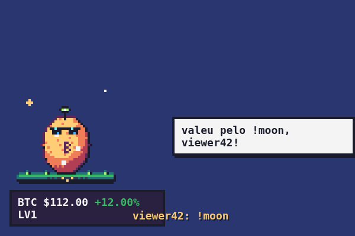

# Streamer overlay (OBS) / Overlay de streamer

The app serves a transparent browser-source page at **`http://127.0.0.1:8737/stream`** (local API, only
`127.0.0.1`). It shows the animated sprite (with your pet's DNA), a speech bubble, price + mood and the last chat
command.

## OBS

1. Sources → **+** → **Browser**.
2. URL `http://127.0.0.1:8737/stream`, width **600**, height **400**.
3. Leave the background transparent (OBS default). Done.

## Twitch chat (optional, keyless)

Menu → **Loja de skins → Overlay de streamer (OBS + Twitch)...** → type your channel name.
The app joins your chat **anonymously** (`justinfan` read-only login, TLS on port 443): no account, no OAuth token,
and it never sends messages. Empty channel = off (the default).

| Command | Effect |
|---|---|
| `!pet` | pet gets a cuddle (hearts) |
| `!moon` / `!dance` | 10 s of TO THE MOON (visual only, the price doesn't change, sadly) |
| `!rekt` | 6 s of drama |
| `!price` | bubble shows the price |
| `!dna` | bubble shows the DNA and rarity |

8 s cooldown between commands, so chat can't spam the pet. Other endpoints: `/overlay` (text-only overlay),
`/status`, `/status.txt`, `/card.svg`, `/sprite.png`.

## pt-BR

OBS → Fonte → Navegador → `http://127.0.0.1:8737/stream` (600×400). Pra ligar o chat da Twitch: menu → Loja de
skins → Overlay de streamer → nome do canal. Leitura anônima, sem conta, sem token, nunca escreve no chat.
